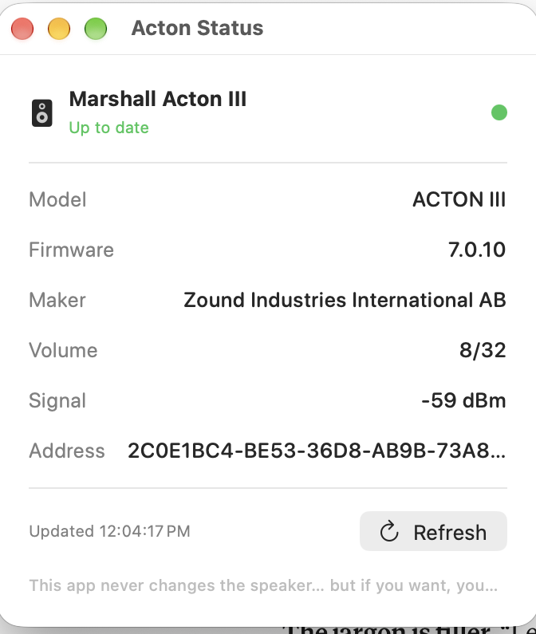

# Marshall Acton III — macOS Bluetooth tools

Small, **read-only** macOS tools for inspecting a Marshall Acton III speaker over
Bluetooth Low Energy. Built with Swift + CoreBluetooth, no dependencies, no Xcode
project — just `swiftc`.

The headline tool, **Acton Status**, is a tiny window that shows live status read
straight from the speaker: model, firmware, maker, current volume, and signal
strength. It's handy for confirming the speaker is actually linked to *this* Mac
and spotting when another device is fighting for it.

> **These tools never write to the speaker.** They only *read* standard Bluetooth
> characteristics. They do not change settings, do not touch firmware/flash, and
> do not send any control, pairing, or erase commands. See [Safety](#safety).



## Why this exists

The Acton III can hold **two** Bluetooth devices connected at once. When a second
device (a phone, a laptop) is also connected, both can send play/pause and grab
the audio, so the music stutters — pausing and resuming every few seconds.

There is no app-based "forget this device" for the Acton III. The clean fix is a
**factory reset**: hold the play/pause control for **more than 10 seconds**, then
re-pair only the device you want. These tools don't replace that — they just give
you a safe, read-only view of what the speaker is doing.

## Tools

| Tool | What it does |
|------|--------------|
| **ActonStatus** | SwiftUI window. Live read-only status + Refresh. The one most people want. |
| **ActonProbe** | CLI. Scans for the speaker and dumps its full GATT services/characteristics. For the curious. |

## Requirements

- macOS 13 or later
- Xcode command-line tools (`xcode-select --install`) for `swiftc`
- A Marshall Acton III, powered on and in range

## Build & run

```bash
git clone https://github.com/mossein/marshall-acton-ble.git
cd marshall-acton-ble
./build.sh
open ./ActonStatus.app
```

The first launch asks for Bluetooth permission — click **Allow**, then **Refresh**
(or ⌘R) in the window.

To explore the raw Bluetooth tree:

```bash
./ActonProbe.app/Contents/MacOS/ActonProbe /tmp/probe.log 12 acton
cat /tmp/probe.log
```

## How it works

The Acton III (made by Zound Industries, on an Airoha chip) exposes a few Bluetooth
LE services. These tools read the standard **Device Information** service (`0x180A`)
for model/firmware/maker, and watch Marshall's own service (`AA00`) for things like
the current volume. Everything shown is obtained with `readValue` — there are no
writes anywhere in the code.

The speaker also exposes Airoha's **RACE** control/debug protocol over GATT. This
repo intentionally does **not** include any RACE command that changes the device.
The protocol's control and flash commands can brick a speaker if misused, and the
"list paired devices" command returns the Bluetooth pairing keys (secrets), so it's
left out on purpose.

## Safety

- ✅ Reads only. No writes, ever.
- ✅ No firmware/flash access.
- ✅ No pairing-key or credential reads.
- ⚠️ To actually clear paired devices, use the 10-second play/pause reset on the
  speaker itself. Don't try to do it over the air — the only way to do that is a
  flash rewrite that can **permanently** brick the speaker.

## Credits

Protocol background came from public research into the Airoha RACE protocol:

- ERNW / insinuator.net — ["Bluetooth Headphone Jacking: Full Disclosure of Airoha
  RACE Vulnerabilities"](https://insinuator.net/2025/12/bluetooth-headphone-jacking-full-disclosure-of-airoha-race-vulnerabilities/)
- [`auracast-research/race-toolkit`](https://github.com/auracast-research/race-toolkit) — RACE protocol framing and GATT UUIDs

Not affiliated with or endorsed by Marshall, Zound Industries, or Airoha.

## License

MIT — see [LICENSE](LICENSE).
